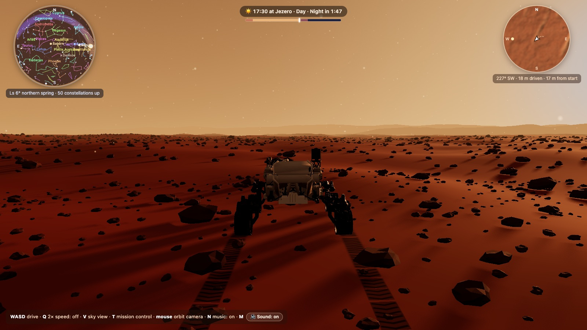
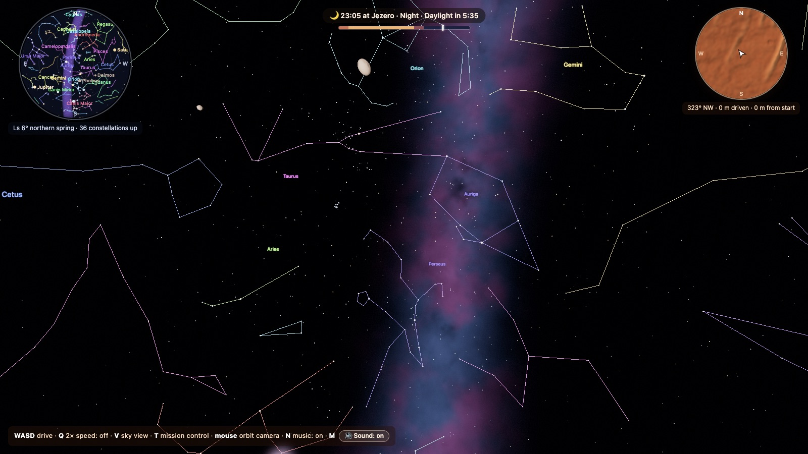
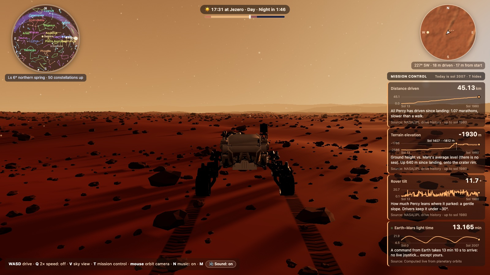
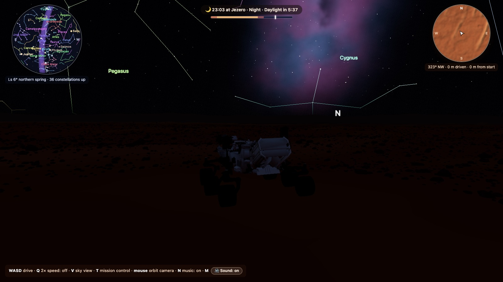

# Perseverancia

**Drive NASA's Perseverance rover across Jezero crater, on today's real Mars, right in your browser.**

A 3D simulation built with [Three.js](https://threejs.org) where the game sits on top of real science: the sky is computed for the actual date and place, the ground follows what orbiters and rovers measured, the sound follows what Perseverance's microphones recorded, and mission control shows NASA's own numbers.

<p align="center">
  
</p>

## What you can do

| | |
|---|---|
| **Drive the rover** | All six wheels roll, the four corner wheels steer, each wheel follows the ground under it, and the tracks show the chevron tread of the real wheels. |
| **Live a real sol** | The sun, planets, Phobos and Deimos are where they really are over Jezero today. A full Martian day lasts 20 minutes: day, dusk, a starry night and dawn. |
| **Find your way by the stars** | 5,044 real stars, all 88 constellations, the Milky Way and a sky chart. Press <kbd>V</kbd> to look straight up from the rover's mast. |
| **Read mission control** | Distance driven, terrain elevation and tilt from NASA's drive log, plus the Earth–Mars light time computed live. |
| **Listen to Mars** | Wind, wheels and motors shaped by the measurements of Perseverance's microphones, with an optional cinematic score on top. |

<p align="center">
  
</p>

## Try it in 2 minutes

You need a recent [Node.js](https://nodejs.org) (we use v24).

```bash
git clone https://github.com/muric-dev/perseverance.git
cd perseverance
npm install
npm run dev
```

Open <http://localhost:5173>. Add `?time=23` to the URL to start at 23:00 local time (any hour works).

| Key | What it does |
|---|---|
| <kbd>W</kbd> <kbd>S</kbd> / <kbd>↑</kbd> <kbd>↓</kbd> | Drive forward and backward |
| <kbd>A</kbd> <kbd>D</kbd> / <kbd>←</kbd> <kbd>→</kbd> | Turn (alone: turn in place; with W: drive an arc) |
| <kbd>Q</kbd> | Double speed on/off |
| <kbd>V</kbd> | Sky view from the mast |
| <kbd>T</kbd> | Show or hide mission control |
| <kbd>N</kbd> | Music on/off |
| <kbd>M</kbd> | All sound on/off |
| Mouse | Orbit the camera around the rover |

## The real science, and how the game uses it

Each table lists the real fact, where it comes from and what the game does with it. Where the game bends reality to stay playable, it says so.

### Speed

| Real fact | Source | In the game |
|---|---|---|
| Top wheel speed: **4.2 cm/s** (about 150 m/h) | [JPL Robotics, Mars 2020 mobility](https://robotics.jpl.nasa.gov/what-we-do/flight-projects/mars-2020-rover/m2020mobility/) | Bent: the rover drives at **3 m/s**, about 71× faster, and <kbd>Q</kbd> doubles that. At real speed, crossing the minimap would take an hour. |
| Self-driving (ENav) averages about 110 m/h; record of 167 m in one autonomous drive on sol 200 | Same | Not simulated: you are the driver. |
| It can turn in place | NASA rover design | <kbd>A</kbd>/<kbd>D</kbd> without <kbd>W</kbd> spins the rover on the spot; the corner wheels steer (up to 70° in the game). |

### Distance

| Real fact | Source | In the game |
|---|---|---|
| **45.13 km** driven by sol 1980 (Sept 2026), from 703 localized stops | [NASA/JPL drive log (M20 waypoints)](https://mars.nasa.gov/mmgis-maps/M20/Layers/json/M20_waypoints.json) | Downloaded live into mission control. Mid-drive stops report a total of 0 m, so the total is the running sum of each leg. |
| Ground elevation went from −2,570 m to −1,930 m: Percy climbed ~640 m onto the crater rim | Same (`elev_geoid`, relative to the areoid, Mars's "sea level") | Mission control chart for the whole mission. |
| Tilt at each stop, from 0.1° to 20.7° | Same (`tilt`) | Mission control chart; the in-game rover also tilts to the slope under its wheels. |
| The minimap counts the meters you drive | — | Your own drive, separate from the real one. |

<p align="center">
  
</p>

### Time

| Real fact | Source | In the game |
|---|---|---|
| A sol (Martian day) lasts **24 h 39 min 35 s** (88,775 s) | Maurice et al. 2022 | Bent: a sol lasts **20 real minutes**: 10 min of day, 1.5 of dusk, 7 of night and 1.5 of dawn. Time runs at a different speed in each phase. |
| Local solar time at Jezero and the season (solar longitude Ls) | Mars24 algorithm (Allison & McEwen 2000) | The clock at the top shows the true local solar time; the sky chart shows the season (e.g. "Ls 6° northern spring"). |
| Day and night limits follow the real sun | Sun altitude for today's date and Jezero's latitude | Day starts when the sun is 3° up; night when it is 9° below the horizon. |
| Landing: 18 Feb 2021, sol 0 | NASA | Mission control counts today's sol (e.g. sol 2007 on 12 Oct 2026). Check: the first drive comes out on sol 13 (4 Mar 2021), as it happened. |
| Light takes **3 to 22 minutes** between Earth and Mars | JPL Keplerian planet elements (Standish) | Computed live every second from both orbits. On landing day it gives 11 min 22 s, matching NASA's figure. |

### Sky and constellations

| Real fact | Source | In the game |
|---|---|---|
| Positions of the sun, Earth, Venus, Jupiter and Saturn | JPL Keplerian elements, valid 1800–2050 | Computed for the current date; accurate to well under a degree. |
| Mars's orientation in space | IAU rotation model (pole and prime meridian) | Turns the whole sky into Jezero's local horizon every frame. |
| **5,044 stars** visible to the naked eye (magnitude ≤ 6), with real colors | [d3-celestial](https://github.com/ofrohn/d3-celestial) catalog (BSD-3) | Placed by right ascension and declination; colored by their B−V index. They don't twinkle (Mars's thin air barely makes them), and dust dims them near the horizon. |
| **88 IAU constellations** | d3-celestial (89 figures: Serpens comes in two halves) | Colored stick figures and names in the sky and on the sky chart. |
| The Milky Way, the Magellanic Clouds and Andromeda | IAU galactic frame (galactic center at RA 266.4°, Dec −28.9°) | Drawn where they really are. |
| From Mars the sun is 0.35° wide, two thirds of what we see from Earth | Mars is at ~1.52 AU | Sun disc at its real size. |
| Butterscotch daytime sky and **blue sunsets**: fine dust scatters blue light forward around the sun | Rover photos of Martian sunsets | Sky shader with a blue halo around the low sun, lingering after sunset. |
| Phobos orbits in 7 h 39 min and rises in the **west**; Deimos takes 30.3 h | Real periods and orbital radii | Real motion and phases. Bent: their starting position along the orbit is approximate, and they are drawn ~10× larger so you can see them. |

<p align="center">
  
</p>

### Terrain

| Real fact | Source | In the game |
|---|---|---|
| Octavia E. Butler Landing: 18.445°N, 77.451°E, inside a 45 km crater | NASA | The horizon shows Jezero's rim (~14 km away to the WNW, ~31 km to the ESE) and the western delta, hidden in part by Mars's curvature. |
| Transverse aeolian ridges (TARs): 1.3 m tall, 17.3 m wide, 88.5 m long, 25.8 m apart | Hugenholtz et al. 2017 (2,295 TARs on HiRISE DTMs) | The ridges on the ground use those dimensions. |
| Rock cover follows F(D) = k·exp(−q·D) | Golombek & Rapp 1997; Golombek et al. 2003 (landing-site model) | k = 8%, between InSight (~3%) and Pathfinder (~19%): about 15,000 rocks. |
| Fresh small craters are ~0.2 times as deep as they are wide; sizes follow N(>D) ∝ D⁻² | Daubar et al. 2014 | 140 craters, from 6 to 80 m, fresh and eroded. |
| Hummocky eroded lava of the Máaz formation | Perseverance's traverse | Small-scale bumps ~25 m across and ~1 m high. |

### The rover

| Real fact | Source | In the game |
|---|---|---|
| 2.7 m wide, 3 m long | NASA | The [official NASA 3D model](https://github.com/nasa/NASA-3D-Resources), scaled to the real width. |
| Six wheels, four of them steer; the rocker-bogie suspension keeps all six on the ground | NASA rover design | Each wheel rolls with the distance, the corner wheels steer and each wheel moves up and down to follow the ground (simplified suspension). |
| Wheels with chevron-shaped grousers | NASA wheel design | Chevron track marks in the sand. |

### Sound

<details open>
<summary>Real measurements behind every sound</summary>

| Real fact | Source | In the game |
|---|---|---|
| The same source sounds about **20 dB weaker** on Mars (air pressure ~0.6 kPa) | Maurice et al. 2022, *Nature* 605 | A quiet mix: about −21 dBFS on average, peaks around −8 dBFS. |
| Wind is turbulence: below ~100 Hz on calm days, ~300 Hz typically, falling very steeply above (slope about f⁻⁴·⁹) | Maurice et al. 2022; Stott et al. 2023 | White noise through a 12 dB/octave and a 6 dB/octave low-pass, with the corner moving between 70 and 260 Hz. |
| Daytime convection makes the wind gusty; at night the stable air almost silences it, and turbulence vanishes at dusk | Maurice et al. 2022 | Wind level follows the daylight; at night only 15% remains. Gusts are a slow random walk, not a regular wobble. |
| High pitches die fast: amplitude falls as e^(−αr) with α = 0.21 /m at 3–6 kHz and 0.34 /m at 6–11 kHz (8 kHz loses 40 dB in 8 m; on Earth, 20 dB) | Maurice et al. 2022 (SuperCam laser sparks at 2–8 m) | Rover sounds pass through two high-shelf filters set from the camera distance, plus the 1/r spreading loss. In sky view (on the mast) they sound closer and brighter. |
| Sound travels at ~240 m/s (about 250 m/s above 240 Hz) | Maurice et al. 2022 | Rover sounds arrive delayed by distance ÷ 240 m/s. |
| Driving is mostly the **bangs, pings and rattles** of the metal wheels on rocks | NASA's [sol 16 drive recording](https://science.nasa.gov/resource/sounds-of-perseverance-mars-rover-driving-sol-16-16-minutes) (EDL microphone) | Random wheel clanks, about one rock every 1.7 m: a dull thud and a short metallic ring. |
| The rover is electric: each wheel has its own actuator, the corner wheels also have steering actuators, and brakes hold the wheels | [JPL](https://www.jpl.nasa.gov/news/another-first-perseverance-captures-the-sounds-of-driving-on-mars); actuators by Cobham (CAES) | Six geared electric motors whose whine follows speed, slightly out of step with each other, plus the higher gear-mesh tone, a steering whir and brake ticks. NASA hasn't published the motor type, so this is a generic gearmotor. |
| The raw recording also has a high-pitched squeak | NASA thinks it may be electrical interference in the microphone | Left out: it may not be a sound in the air. |

The **music is not real**: it's a cinematic score generated live (D minor strings and drone in a large reverb). Driving brings in a pulsing low-string ostinato and deep drums; at night a soft celesta joins the stars. <kbd>N</kbd> turns it off to hear Mars alone.

</details>

### Mission control

The panel follows the telemetry pattern of NASA's [Open MCT](https://nasa.github.io/openmct/): every value has a **name**, a **unit** and a **provider** that knows how to bring its history and, if it can, live values. The x axis of every chart is the mission sol.

| Value | Unit | Provider |
|---|---|---|
| Distance driven | km | NASA/JPL drive log, downloaded live |
| Terrain elevation | m | NASA/JPL drive log |
| Rover tilt | ° | NASA/JPL drive log |
| Earth–Mars light time | min | Computed live from the planets' orbits |

## Where the game bends reality

- The rover is about 71× faster than the real one, and a sol lasts 20 minutes.
- Phobos and Deimos are ~10× larger than they look from the surface, and their starting position along the orbit is approximate.
- Nights are brighter than the real Martian night so you can still drive.
- The music is a game score; everything else in the soundscape follows the measurements above.

## How it's organized

```
src/
  main.js        builds the scene and runs the game loop
  config.js      shared values (start position, Mars radius)
  astro/         ephemeris (sun, planets, moons, Mars time, light time) and the game clock
  world/         terrain, rocks, craters, horizon, sky, stars, Milky Way, moons, dust, lights
  rover/         NASA model, driving, wheels, tracks, follow camera
  ui/            clock, minimap and sky chart
  core/          renderer, keyboard, sound (audio.js) and music (music.js)
  mission/       mission control, as a plug-in (Open MCT pattern)
  data/          stars and constellations (built by scripts/build-sky-data.mjs)
scripts/check.mjs  automated check with screenshots
```

## Check it

With `npm run dev` running and Google Chrome installed:

```bash
npm run check
```

It opens the game in headless Chrome, drives the rover, checks that mission control's 4 values load real numbers (and that light time updates live), checks that <kbd>T</kbd> hides the panel, takes screenshots by day, at night and in sky view, and fails if the console has any error or warning.

## Build on top of it

- **Real-delay driving:** commands that reach the rover after the real light time.
- **The real route:** draw the 45 km Percy has driven, from the same NASA log.
- **Self-driving:** let the rover avoid rocks on its own, like ENav.
- **Ingenuity:** its rotor hum was recorded at 84 Hz by the same microphone.
- **Dust devils and storms**, and their sound.

## Credits and sources

- Inspiration: [Feloguarin](https://github.com/Feloguarin) and the [perseverancia](https://github.com/Feloguarin/perseverancia) repository from their Claude Code course. This project and its README were inspired by that work.
- Rover model: [NASA 3D Resources](https://github.com/nasa/NASA-3D-Resources). Drive log: NASA/JPL-Caltech.
- Stars and constellations: [d3-celestial](https://github.com/ofrohn/d3-celestial) by Olaf Frohn (BSD-3-Clause).
- Maurice, S. et al. (2022). [In situ recording of Mars soundscape](https://authors.library.caltech.edu/records/yymhf-wyt75). *Nature* 605, 653–658.
- Stott, A. E. et al. (2023). [Wind and Turbulence Observations With the Mars Microphone on Perseverance](https://deepblue.lib.umich.edu/handle/2027.42/176833). *JGR Planets*.
- NASA/JPL: [Perseverance captures the sounds of driving on Mars](https://www.jpl.nasa.gov/news/another-first-perseverance-captures-the-sounds-of-driving-on-mars).
- Allison, M. & McEwen, M. (2000). Mars24 time algorithm. Standish, E. M. Approximate Positions of the Planets (JPL).
- Hugenholtz, C. et al. (2017), transverse aeolian ridges. Golombek, M. & Rapp, D. (1997) and Golombek, M. et al. (2003), rock abundance. Daubar, I. et al. (2014), fresh craters.
- All images in this README are real screenshots of the game.
- A community project, **not affiliated with NASA**.
